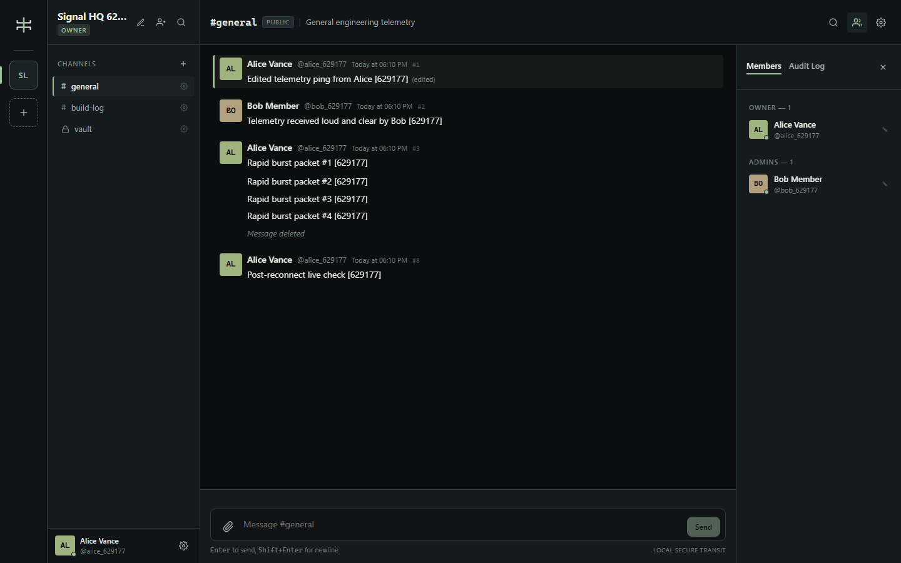
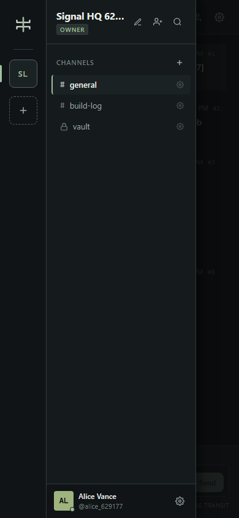
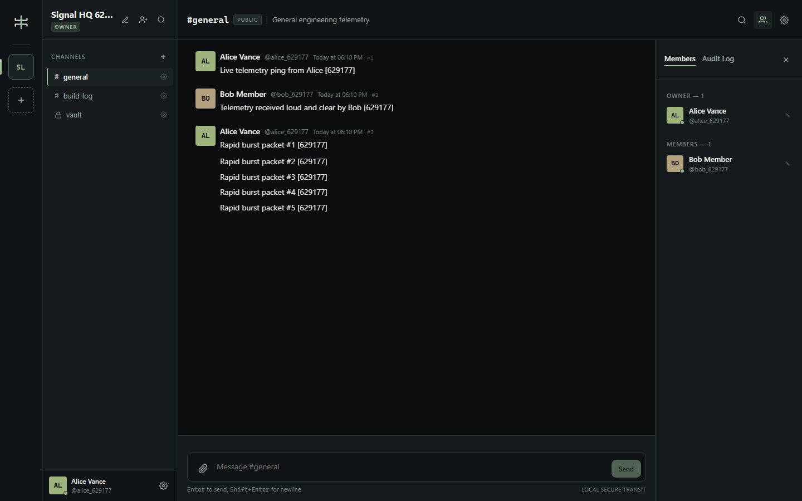
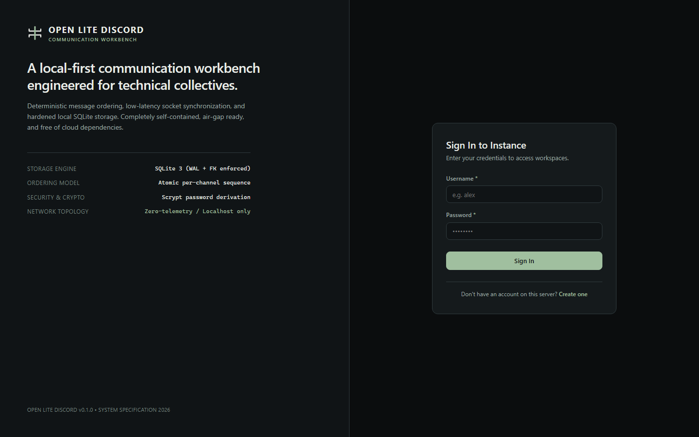

# 🚀 Open Lite Discord

> **A local-first, zero-telemetry community communication workbench engineered for technical collectives, privacy-conscious teams, and air-gapped environments.**

[](LICENSE)
[](https://www.typescriptlang.org/)
[](https://www.fastify.io/)
[](https://react.dev/)
[](https://www.sqlite.org/)
[](https://socket.io/)
[](https://vitest.dev/)
[](https://playwright.dev/)
[](#security--air-gap-guarantees)

---

## 📌 Overview

**Open Lite Discord** is a full-featured, high-performance community messaging platform built from the ground up to operate completely on local infrastructure. It delivers the rich interactive UX of modern chat software—channels, realtime socket synchronization, markdown formatting, file attachments, roles, invites, search, and audit logs—while guaranteeing **100% data sovereignty, deterministic message ordering, and zero external cloud dependencies**.

Whether deployed on a local workstation, an intranet server, or a disconnected field network, Open Lite Discord requires no external APIs, hosted databases, third-party authentication providers, CDNs, or telemetry.

---

## ⚡ Key Highlights & Capabilities

### 🛡️ 1. Zero-Cloud & Air-Gap Ready
- **Completely Self-Contained:** Zero runtime network calls to external CDNs, cloud authentication, telemetry, or remote APIs.
- **Embedded Database:** Powered by native SQLite 3 in Write-Ahead Logging (WAL) mode with foreign key enforcement and persistent disk storage.
- **Single-Origin Deployment:** In production, Fastify serves the typed REST API, Socket.IO gateway, and optimized React SPA from a single HTTP port.

### ⏱️ 2. Deterministic Message Ordering & Nonce Idempotency
- **Atomic Sequences:** Every message within a channel receives a monotonically increasing sequence number assigned inside an atomic database transaction.
- **Guaranteed Consistency:** Eliminates clock skew and race conditions across concurrent clients.
- **Idempotent Retries:** Client-generated UUID nonces guarantee network retries never duplicate messages or disrupt timeline sequence ordering.

### ⚡ 3. Real-Time Socket.IO Synchronization
- **Live Event Bus:** Real-time message creation, edits, soft-deletions, channel creation, and membership changes propagate instantly to connected clients.
- **Typing & Presence:** In-memory presence tracker and debounced typing indicator broadcast across active channels.
- **Dynamic Authorization & Instant Room Ejection:** Revoking a user's access to a private channel or space immediately evicts their socket rooms and updates client state in real time.
- **Seamless SPA Reconnect:** Automatic session re-authentication and sequence backlog recovery on network reconnection or SPA login/logout.

### 🔒 4. Hardened Security Model
- **Native Password Hashing:** Node.js native `crypto.scrypt` with random 16-byte salts and verified parameter derivation.
- **Opaque Token Hashing:** Plaintext session cookies and invite tokens are never stored in the database; only SHA-256 cryptographic hashes are persisted.
- **CSRF Origin Defense:** Mutating requests (`POST`, `PATCH`, `DELETE`) enforce strict Origin header verification against authorized local hosts.
- **Comprehensive Rate Limiting:** In-memory sliding-window rate limiters defend against brute-force attacks across registration/login, invite redemption, message creation, and typing events.
- **Safe File Attachments:** Strict MIME allowlisting (`image/png`, `image/jpeg`, `image/gif`, `image/webp`, `text/plain`, `application/pdf`), 5MB size caps, filename path traversal sanitization, and `X-Content-Type-Options: nosniff` headers.
- **FTS5 Soft-Delete Safety:** SQLite triggers ensure soft-deleted messages (`body = NULL`) are purged from full-text search indexes immediately.

### 🎨 5. Editorial Technical UI Design
- **Original Visual Language:** Dark graphite aesthetic (`#0B0D0E` canvas, `#151A1C` / `#1B2224` surfaces, `#A0BF9F` mint-olive accent) designed with crisp 1px strokes.
- **Zero Visual Shortcuts:** No generic AI templates, no blurry glassmorphism, no neon glows, and no distracting gradient fills.
- **Responsive Breakpoints:** Fully responsive 4-column workbench adapting fluidly across Desktop (`1440x900`), Compact Laptop (`1024x768`), Tablet (`768x1024`), Mobile (`390x844`), and Ultra-Narrow (`320x720`) with dedicated slide-over navigation drawers.
- **Full Keyboard Navigation:** Global keyboard shortcuts (`Enter` send, `Shift+Enter` newline, `Ctrl+K` search, `Escape` close modal, accessible Tab focus rings).

---

## 🏛️ Monorepo Architecture

Open Lite Discord is organized as an npm workspace monorepo:

```text
Open-Lite-Discord/
├── apps/
│   ├── server/             # Node.js + Fastify + Socket.IO + SQLite backend
│   │   ├── src/
│   │   │   ├── auth/       # Scrypt auth, session management, permissions, CSRF origin check
│   │   │   ├── db/         # SQLite connection singleton, migrations, seed, reset
│   │   │   ├── domains/    # Spaces, Channels, Messages, Mutations, Members, Invites, Search, Uploads
│   │   │   ├── realtime/   # Socket.IO setup, presence tracking, room authorization
│   │   │   ├── config.ts   # Environment & local network configuration
│   │   │   └── index.ts    # Fastify entrypoint & static SPA handler
│   │   └── package.json
│   └── web/                # React 18 + Vite 6 + TypeScript + TanStack Query frontend
│       ├── src/
│       │   ├── components/ # AppShell, ResponsiveNavigation, Dialog, Button, Input, Icons
│       │   ├── features/   # Auth, Spaces, Channels, Messages, Members, Search, Settings, Invites
│       │   ├── hooks/      # useApi, useCurrentUser, useConnectionState, useRealtimeMessages
│       │   ├── styles/     # Design system tokens (tokens.css) & reset (app.css)
│       │   └── main.tsx    # React root entry
│       ├── index.html
│       └── package.json
├── packages/
│   └── contracts/          # Shared TypeScript DTOs & Zod validation schemas
│       ├── src/
│       │   ├── index.ts    # Request/response DTOs, schemas, enums
│       │   └── events.ts   # Socket.IO bidirectional client/server event signatures
│       └── package.json
├── tests/
│   ├── integration/        # Vitest backend integration & security tests
│   │   ├── core.test.ts    # Auth, CRUD, migrations, sequence ordering, FTS search, cursors
│   │   └── security.test.ts# Channel isolation, CSRF origin, traversal, rate limits, role sync
│   └── e2e/                # Playwright full-chain browser E2E suites
│       ├── chat.spec.ts    # Two-user live chat, rapid burst, private channel grant/revoke, responsive
│       ├── durability.spec.ts # 500+ messages, cursor pagination, zero external network, backend restart
│       └── accessibility.spec.ts # Keyboard navigation, ARIA attributes, 320px mobile composer
├── evidence/
│   └── screenshots/        # Real Chromium audit screenshots captured during E2E verification
├── docs/                   # Architectural blueprints, API docs, schema diagrams, security audits
├── eslint.config.js        # Strict ESLint 9 TypeScript flat configuration
├── vitest.config.ts        # Vitest integration configuration
├── playwright.config.ts    # Playwright browser testing configuration
├── FINAL_AUDIT.md          # 30-task independent verification & audit acceptance report
└── package.json            # Monorepo root scripts & devDependencies
```

---

## 🖼️ Application Interface & Evidence

| Desktop 4-Column Workbench (`1440x900`) | Mobile Navigation Drawer (`390x844`) |
|:---:|:---:|
|  |  |

| Two-User Realtime Chat Synchronization | Technical Auth & Instance Specs |
|:---:|:---:|
|  |  |

*(All screenshots are captured during automated Playwright browser test runs against live application code).*

---

## 🚀 Quick Start Guide

### Prerequisites
- **Node.js:** `v20.x` or `v22.x LTS` (or `v24.x`)
- **npm:** `v10.x` or higher
- **Git**

### 1. Clone the Repository
```bash
git clone https://github.com/THE-SHRIKS/Open-Lite-Discord.git
cd Open-Lite-Discord
```

### 2. Install Dependencies
```bash
npm install
```

### 3. Initialize Database & Seed Demo Data
```bash
# Run SQLite database migrations (creates all 11 tables & FTS5 triggers)
npm run db:migrate

# Seed demo workspace and test user accounts
npm run seed:demo
```

### 4. Build & Start the Server
```bash
# Build contracts, server, and web frontend
npm run build

# Start the unified local server
npm start
```

🎉 Open your browser and navigate to:  
👉 **[http://127.0.0.1:3001](http://127.0.0.1:3001)**

---

## 🔑 Pre-Seeded Demo Credentials

After running `npm run seed:demo`, you can log in immediately with either account:

| User | Username | Password | Role | Description |
| :--- | :--- | :--- | :--- | :--- |
| **Alice Vance** | `alice` | `SidebandPass123!` | `Owner` | Workspace owner with full administration privileges |
| **Bob Mercer** | `bob` | `SidebandPass123!` | `Member` | Standard member for two-user testing & chat |

*Default Seed Workspace:* **Open Lite Discord HQ** (`#general`, `#build-log`, `#core-security` private channel).

---

## 🛠️ Development Mode (Hot Reload)

For active local development with hot module replacement (HMR) on the frontend:

```bash
# Runs Fastify (port 3001) and Vite dev server (port 5173) concurrently
npm run dev
```

The Vite dev server proxies `/api/v1` and `/socket.io` to the Fastify backend automatically.

---

## 🧪 Comprehensive Verification Suite

Open Lite Discord includes a 100% automated verification pipeline:

```bash
# Run the entire verification gate (typecheck, lint, integration tests, build, E2E tests)
npm run verify:all
```

### Individual Check Commands:
```bash
# 1. Strict TypeScript typechecking across all 3 workspaces
npm run typecheck

# 2. Linting (ESLint 9 flat config with zero warnings allowed)
npm run lint

# 3. Vitest Integration & Security Suite (34 tests)
npm run test

# 4. Playwright End-to-End Browser Tests (Chromium headless)
npm run test:e2e

# 5. Static Network Audit (checks for non-local URL literals)
python scripts/network_audit.py
```

### Verified Test Results:
- ✅ **Unit & Integration Suite:** `34 / 34 passed` (`core.test.ts`, `security.test.ts`)
- ✅ **Playwright E2E Suite:** `4 / 4 passed` (`chat.spec.ts`, `durability.spec.ts`, `accessibility.spec.ts`)
- ✅ **Durability & Performance:** `505+` consecutive messages loaded and paginated smoothly.
- ✅ **Backend Restart Durability:** Zero data loss and seamless client reconnection across complete server shutdown.
- ✅ **Air-Gap Verification:** `0` non-local requests recorded during full browser sessions.

*(See [FINAL_AUDIT.md](FINAL_AUDIT.md) for full requirement-by-requirement verification matrices).*

---

## 📡 REST API & Socket.IO Reference

All HTTP API endpoints use the `/api/v1` prefix and return standard `{ data: T }` or `{ error: { code, message } }` JSON envelopes.

### Authentication (`/api/v1/auth`)
- `POST /api/v1/auth/register` — Create local account (username, displayName, password)
- `POST /api/v1/auth/login` — Authenticate and issue secure `HttpOnly` session cookie
- `POST /api/v1/auth/logout` — Invalidate session and clear cookie
- `GET /api/v1/auth/me` — Retrieve authenticated user profile
- `PATCH /api/v1/auth/me` — Update user profile display name

### Workspaces & Channels (`/api/v1/spaces`, `/api/v1/channels`)
- `GET /api/v1/spaces` — List workspaces joined by user
- `POST /api/v1/spaces` — Create a new workspace
- `PATCH /api/v1/spaces/:id` — Update workspace name/badge (Admin/Owner)
- `DELETE /api/v1/spaces/:id` — Delete workspace and cascade all data (Owner only)
- `GET /api/v1/spaces/:id/members` — List members, roles, and live online presence
- `PATCH /api/v1/spaces/:id/members/:userId` — Promote/demote member role
- `DELETE /api/v1/spaces/:id/members/:userId` — Remove member from workspace
- `GET /api/v1/spaces/:id/channels` — List accessible public and private channels
- `POST /api/v1/spaces/:id/channels` — Create channel (`public` or `private`)
- `PATCH /api/v1/channels/:id` — Update channel name/topic
- `DELETE /api/v1/channels/:id` — Archive channel
- `GET /api/v1/channels/:id/members` — List regular members granted access to private channel
- `POST /api/v1/channels/:id/members` — Grant access to private channel
- `DELETE /api/v1/channels/:id/members/:userId` — Revoke access (instantly ejects socket room)

### Messages & Search (`/api/v1/channels/:id/messages`, `/api/v1/search`)
- `GET /api/v1/channels/:id/messages?before=<seq>&after=<seq>&limit=50` — Cursor-paginated message history
- `POST /api/v1/channels/:id/messages` — Send message with `clientNonce` and optional attachment IDs
- `PATCH /api/v1/messages/:id` — Edit message content (author or moderator)
- `DELETE /api/v1/messages/:id` — Soft-delete message (sets tombstone, clears body, purges from FTS5)
- `POST /api/v1/channels/:id/read` — Upsert read cursor and clear unread badge
- `GET /api/v1/search?q=<query>&spaceId=<id>` — Full-text search across accessible channels

### Invites & Uploads (`/api/v1/invites`, `/api/v1/uploads`)
- `POST /api/v1/spaces/:id/invites` — Generate invite with custom expiry hours and max uses
- `GET /api/v1/spaces/:id/invites` — List active workspace invites
- `DELETE /api/v1/invites/:id` — Revoke active invite
- `POST /api/v1/invites/redeem` — Atomically redeem invite and join workspace
- `POST /api/v1/channels/:id/uploads` — Upload attachment file (multipart, max 5MB)
- `GET /api/v1/attachments/:id` — Securely stream attachment bytes (with channel access checks)

### Real-Time Socket.IO Events
- **Client to Server:** `channel:subscribe`, `channel:unsubscribe`, `space:subscribe`, `typing:set`
- **Server to Client:** `message:created`, `message:updated`, `message:deleted`, `channel:created`, `channel:updated`, `space:updated`, `space:deleted`, `membership:updated`, `presence:changed`, `typing:changed`, `access:revoked`

---

## 📜 License

This project is licensed under the **MIT License**. See the [LICENSE](LICENSE) file for details.
